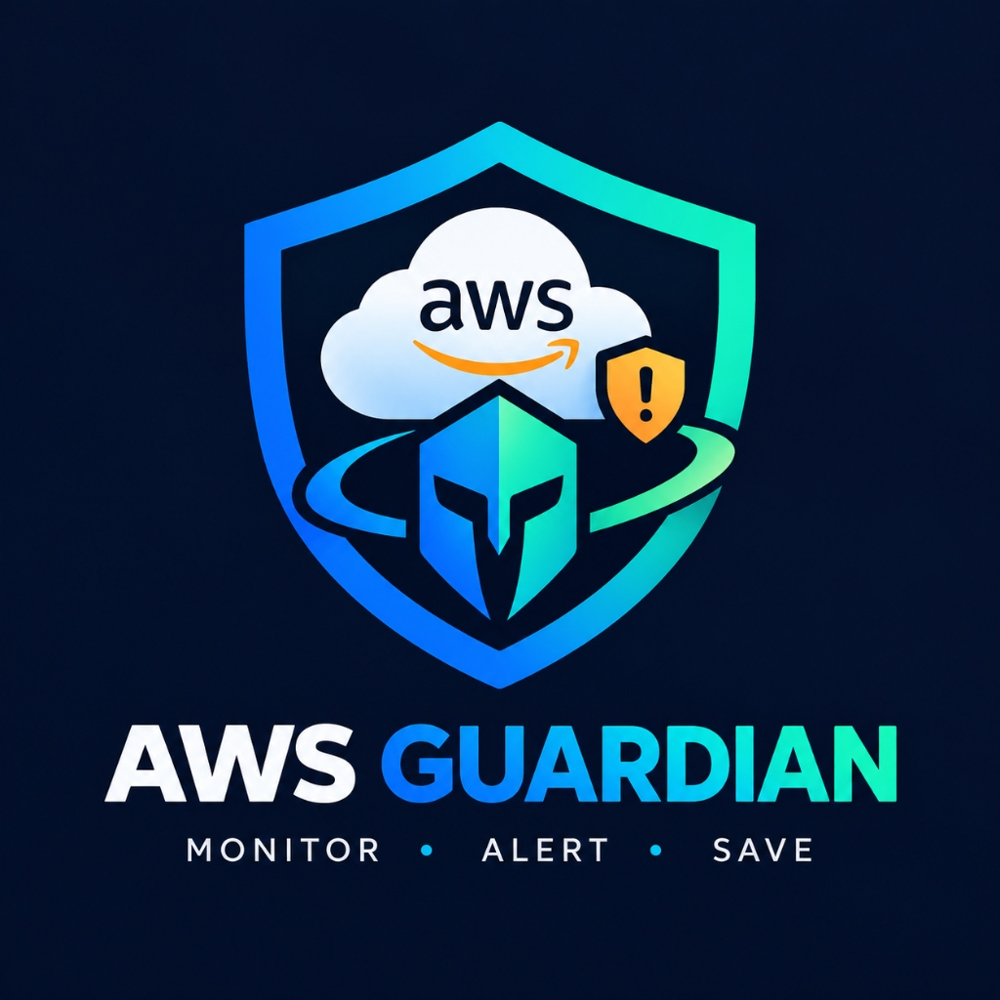

<div align="center">
  
  <h1>AWS Guardian</h1>
  <p><strong>"Find what you forgot. Protect your AWS bill."</strong></p>
</div>

AWS Guardian is an enterprise-grade cloud resource monitoring, forgotten resource detection, and cost protection Flutter mobile application and Django REST backend.

---

## 🌟 Key Features

- **Zero Permanent AWS Credentials**: Connect AWS accounts using IAM Role ARN + External ID with **AWS STS AssumeRole**.
- **Multi-Service Cloud Scanners**: Deep multi-region inspection for EC2, EBS, Elastic IP, NAT Gateways, RDS Databases, S3 Buckets, and Elastic Load Balancers (ELB).
- **Intelligent Rule Engine**: Automatically detects long-running test EC2 instances, unattached EBS volumes, unassociated Elastic IPs, idle NAT gateways, and permissive S3 buckets.
- **Smart Alert Deduplication**: Keeps one active alert per issue, updates detection timestamps, and automatically resolves cleared conditions.
- **Modern Minimalist Dark UI/UX**: Dark-first Material 3 design system with custom `#080D18` palette and fluid interactive FL Charts.
- **Twice-Daily & Instant Alerts**: Scheduled Morning (09:00) & Evening (19:00) summaries delivered to In-App notification logs and Telegram Bot.
- **Safe Operations**: Safe EC2 Stop action with confirmation dialogs and destructive resource deletion with **type-to-confirm** protection. Never auto-deletes.
- **Multi-Tenant Isolation & Audit Trail**: Strict per-user database isolation with an immutable audit log sanitizing all sensitive parameters.

---

## 🏗️ Architecture

```text
Flutter Mobile App (Material 3 • Riverpod • GoRouter • FL Chart)
        ↓ HTTPS REST API (JWT Bearer)
Django REST Framework Backend (Multi-Tenant Isolation)
        ↓
PostgreSQL / SQLite Database
        ↓
Boto3 AWS Client
        ↓ AWS STS AssumeRole (External ID Handshake)
Customer AWS Account (Multi-Region Read-Only Inspection)
```

---

## 🚀 Quick Start

### 1. Backend Setup

```bash
cd backend
python -m venv venv
# Windows:
venv\Scripts\activate
# Linux/macOS:
source venv/bin/activate

pip install -r requirements.txt
python manage.py migrate
python manage.py test
python manage.py runserver 0.0.0.0:8000
```

### 2. Flutter Mobile Setup

```bash
cd mobile
flutter pub get
flutter test
flutter run
```

### 3. Docker Compose Setup

```bash
docker compose up --build -d
```

---

## 🧪 Testing

### Backend Tests (21 Unit & Integration Tests)
```bash
cd backend
python manage.py test
```

Tests cover:
- Custom JWT User Authentication & Registration
- Multi-Tenant DB Isolation
- STS AssumeRole Role ARN Validation & Handshake
- Rule Engine Evaluation (EC2, EBS, EIP, RDS, NAT, S3, ELB)
- Alert Deduplication & Auto-Resolution
- Safe Stop Instance & Type-to-Confirm Deletion
- Audit Trail Logging & Sensitive Secret Sanitization
- Telegram Bot Dispatcher

### Flutter Tests
```bash
cd mobile
flutter analyze
flutter test
```

---

## 📱 Mobile App Screens

- **Splash Screen**: Animated logo, tagline, auto-session routing.
- **Onboarding**: 3 interactive slides with persistent state.
- **Authentication**: Sign In, Register, Forgot Password with input validation.
- **Dashboard**: 4 metric cards, Risk Donut Chart, Resources by Service, Recent Alerts, Quick Actions (Scan Now, View Alerts, Connect AWS, Notifications).
- **AWS Accounts**: Connected accounts list, connection status, last scan time.
- **Connect AWS Wizard**: 3-step connection with unique External ID copy and IAM guide.
- **IAM Setup Instructions**: 10-step guide with trust policy snippet and "Open AWS Console" link.
- **Resources**: Search, Service chips (EC2, EBS, RDS, S3, ELB, EIP, NAT), Region & Risk filter sheets, Resource Cards.
- **Resource Details**: Full metadata breakdown, Risk analysis, Safe Stop Instance, Type-to-Confirm Delete, Open AWS Console.
- **Alerts**: Severity chips (Critical, High, Medium, Low, Active, Resolved), Alert Cards, Acknowledge & Resolve actions.
- **Costs**: Actual vs Estimated breakdown, transparent cost state, cost by service.
- **Analytics**: 7-day trend chart, Regional breakdown, Risk distribution, Resolved metrics using FL Chart.
- **Notifications**: History of morning/evening digests, on-demand dispatch trigger, Telegram test message.
- **Activity & Audit**: Complete immutable operational audit trail with timestamps.
- **Settings**: Profile edit, Change password, Scanning intervals, Notification schedules, Dark/Light appearance, Base API URL configuration.
- **Help & FAQs**: Expandable accordion cards explaining IAM, External ID, safety principles.
- **About**: App version, architecture summary, and security policy.

---

## 🔒 Security Principles

1. **Zero Permanent Secrets**: We never ask for or store AWS access keys or passwords.
2. **Never Auto-Delete**: Guardian only detects, explains, and recommends. Actions require explicit human confirmation.
3. **Least Privilege**: Only read-only Describe permissions are needed for monitoring.

---

## 📄 License
MIT License. Built for cloud security engineers and AWS architects.
